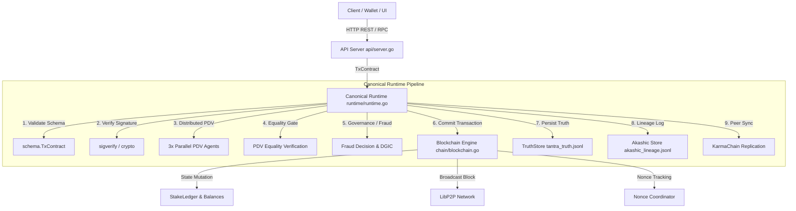

# VAJRA Codebase Architectural Map

**Author / Contributor:** Ishan Shirode  
**Role:** VAJRA Go + Blockchain Engineering Apprenticeship and Production Support  
**Lead / Technical Direction:** Prakash Kumar  
**Target Codebase:** `BHIV-Engineering-Exchange/bhiv-VAJRA_Blockchain`  

---

## 1. System Overview & Subsystem Boundaries

The VAJRA Blockchain is an enterprise-grade Layer-1 blockchain featuring:
- **Proof-of-Stake Consensus** with validator selection, stake snapshots, and slashing.
- **9-Stage Deterministic Runtime Engine** with Distributed Parallel Distributed Verification (PDV).
- **Akashic Lineage Ledger** & **KarmaChain Replication** for immutable provenance and replay mitigation.
- **Cybersecurity & AI Fraud Integration** for runtime threat protection.
- **Cross-Chain Bridge & DEX Subsystems** for multi-chain interoperability and asset swapping.

---

## 2. Directory & Module Matrix

| Directory / Package | Subsystem Function | Key Files / Entry Points | Primary API / Interfaces | Test Coverage & Evidence |
|---|---|---|---|---|
| [`core/relay-chain/cmd/relay`](file:///g:/VAJRA/core/relay-chain/cmd/relay) | Relay node entry point & main runtime loop | [`main.go`](file:///g:/VAJRA/core/relay-chain/cmd/relay/main.go) | CLI flag parsing, P2P bootnode listener, HTTP REST server | `startupcheck`, `selftest` |
| [`core/relay-chain/chain`](file:///g:/VAJRA/core/relay-chain/chain) | Core blockchain ledger, blocks, transactions, P2P | [`blockchain.go`](file:///g:/VAJRA/core/relay-chain/chain/blockchain.go), [`transaction.go`](file:///g:/VAJRA/core/relay-chain/chain/transaction.go), [`block.go`](file:///g:/VAJRA/core/relay-chain/chain/block.go), [`p2p.go`](file:///g:/VAJRA/core/relay-chain/chain/p2p.go) | `NewBlockchain`, `ProcessTransaction`, `AddBlock`, `MinePendingTransactions` | [`peer_identity_test.go`](file:///g:/VAJRA/core/relay-chain/chain/peer_identity_test.go), [`reward_inflation_test.go`](file:///g:/VAJRA/core/relay-chain/chain/reward_inflation_test.go) |
| [`core/relay-chain/runtime`](file:///g:/VAJRA/core/relay-chain/runtime) | Canonical 9-stage deterministic execution pipeline | [`runtime.go`](file:///g:/VAJRA/core/relay-chain/runtime/runtime.go) | `Execute(ExecutionRequest) ExecutionResult`, `BlockchainWriter` interface | [`runtime_test.go`](file:///g:/VAJRA/core/relay-chain/runtime/runtime_test.go) |
| [`core/relay-chain/crypto`](file:///g:/VAJRA/core/relay-chain/crypto) | Cryptographic primitives & ECDSA key management | [`crypto.go`](file:///g:/VAJRA/core/relay-chain/crypto/crypto.go) | `GenerateKeyPair`, `ParsePublicKey`, `PublicKeyToString` | Crypto verification assertions in `chain` tests |
| [`core/relay-chain/consensus`](file:///g:/VAJRA/core/relay-chain/consensus) | PoS validator selection & block validation | [`validator.go`](file:///g:/VAJRA/core/relay-chain/consensus/validator.go) | `SelectValidator`, `ValidateBlock`, `RewardValidator` | PoS round validation in `chain/blockchain.go` |
| [`core/relay-chain/pdv`](file:///g:/VAJRA/core/relay-chain/pdv) | Distributed Parallel Verification (3 independent agents) | [`pdv.go`](file:///g:/VAJRA/core/relay-chain/pdv/pdv.go) | `Check(AgentRequest) DistributedPDVResult` | `cmd/pdv-convergence-e2e` |
| [`core/relay-chain/enforcement`](file:///g:/VAJRA/core/relay-chain/enforcement) | Signature & governance rule enforcement | [`enforcement.go`](file:///g:/VAJRA/core/relay-chain/enforcement/enforcement.go) | `Enforce(TxPayload) EnforcementResult` | Integration tests in `runtime` |
| [`core/relay-chain/akashic`](file:///g:/VAJRA/core/relay-chain/akashic) | Immutable audit lineage and hash chaining | [`akashic.go`](file:///g:/VAJRA/core/relay-chain/akashic/akashic.go) | `Store.Append`, `VerifyLineageChain` | `akashic_lineage.jsonl` |
| [`core/relay-chain/truthstore`](file:///g:/VAJRA/core/relay-chain/truthstore) | Truth record persistence | [`truthstore.go`](file:///g:/VAJRA/core/relay-chain/truthstore/truthstore.go) | `Store.Append`, `Store.Read` | `tantra_truth.jsonl` |
| [`core/relay-chain/noncecoord`](file:///g:/VAJRA/core/relay-chain/noncecoord) | Global nonce coordination & replay mitigation | [`noncecoord.go`](file:///g:/VAJRA/core/relay-chain/noncecoord/noncecoord.go) | `Coordinator.ValidateAndConsume` | `cmd/nonce-coord-proof` |
| [`core/relay-chain/api`](file:///g:/VAJRA/core/relay-chain/api) | HTTP REST API endpoints | [`server.go`](file:///g:/VAJRA/core/relay-chain/api/server.go) | `NewAPIServer`, `/api/v1/status`, `/api/v1/transaction` | REST endpoint testing |
| [`core/relay-chain/dex`](file:///g:/VAJRA/core/relay-chain/dex) | Decentralized exchange & AMM pool logic | [`dex.go`](file:///g:/VAJRA/core/relay-chain/dex/dex.go) | `CreatePool`, `Swap`, `AddLiquidity` | `DEX_TESTING_GUIDE.md` |
| [`core/relay-chain/otc`](file:///g:/VAJRA/core/relay-chain/otc) | OTC order matching & settlement | [`otc.go`](file:///g:/VAJRA/core/relay-chain/otc/otc.go) | `CreateOrder`, `FillOrder`, `CancelOrder` | E2E OTC tests |
| [`core/relay-chain/cybersecurity`](file:///g:/VAJRA/core/relay-chain/cybersecurity) | Cybercrime defense & blacklist enforcement | [`cybercrime.go`](file:///g:/VAJRA/core/relay-chain/cybersecurity/cybercrime.go) | `CheckAddress`, `ReportMalicious` | `start_cybersecurity_system.bat` |
| [`core/relay-chain/monitoring`](file:///g:/VAJRA/core/relay-chain/monitoring) | Performance metrics & node health | [`monitoring.go`](file:///g:/VAJRA/core/relay-chain/monitoring/monitoring.go) | `InitializeGlobalMonitor`, `RecordMetric` | Prometheus metrics scrape |

---

## 3. Dependency Graph & Interaction Flow

---

## 4. Known Gaps & Action Items for Apprenticeship Support

1. **Structured Diagnostic Endpoints:** Provide dedicated runtime inspection endpoints for node operators.
2. **Unified Integration Test Harness:** Automate valid/invalid/replay scenario checks directly against running node instances.
3. **Automated Replay Proof Verification:** Enhance CLI tools for validating full cryptographic replay chains.
